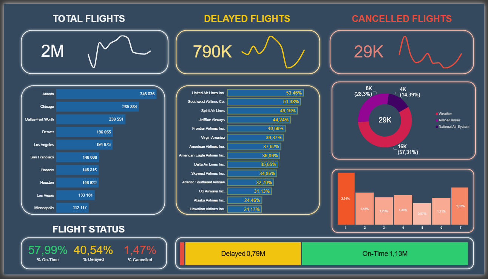

# ✈️ Flight Status Dashboard | Power BI

## Project Overview

An interactive **Flight Status Dashboard** built in Power BI to analyze flight performance, delays, cancellations and airline operations.
The dashboard provides an overview of flight statistics and helps identify patterns in flight delays and cancellations.

## Dashboard Features

- **Flight Statistics** – Overview of total, delayed, and cancelled flights, including trends over time.
- **Total Flights by City** – Analysis of flight volume across different cities.
- **Delayed Flights by Airport** – Comparison of delayed flights across airports.
- **Cancellation Reasons** – Breakdown of flight cancellations by reason.
- **Cancellations by Day of the Week** – Analysis of the number of cancelled flights across the seven days of the week.
- **Flight Status Distribution** – Percentage breakdown of on-time, delayed, and cancelled flights, presented in a column chart.

## Tools & Technologies

- **Power BI** – Dashboard development and data visualization.
- **Power Query** – Data cleaning and transformation.
- **DAX** – Measures and KPI calculations.

## Key Insights

- Approximately 2 million flights are included in the analysis.
- 57.99% of flights arrived or operated on time, according to the dashboard's status definition.
- 40.54% of flights were delayed.
- 1.47% of flights were cancelled.
- Weather was the largest cancellation category, accounting for 57.31% of cancellations.

## Repository Contents

This repository includes all files used to create the Flight Status Dashboard:

- 4 Data Tables – Source tables used for data preparation, analysis and dashboard development.
 - **flights** (the table was reduced by removing some records to decrease the overall file size and improve performance)
 - **airlines**
 - **airports**
 - **cancellation_codes**

- Power BI File (.pbix) – The interactive dashboard and data model.
- Dashboard Screenshot (.png) – A preview of the final dashboard.

## Dominika Schabowska
